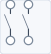

# electro-svgs

Biblioteca de símbolos eléctricos en formato SVG: esquemáticos (IEC 60617 / UNE), iconos de panel e ilustraciones para documentación técnica.

## Propósito

Centralizar los SVG eléctricos que hoy están repartidos entre proyectos (simulador, calculistas e interfaces) en un único lugar, con convenciones consistentes de nombre, dimensiones y trazos. El objetivo es que cualquier herramienta del ecosistema pueda consumir los mismos símbolos sin duplicarlos ni convertirlos.

Esto **no** es un editor ni un simulador: solo contiene los recursos gráficos y su inventario.

## Origen y estado actual

Los 227 archivos de `symbols/componentes/` son una **copia** de `REA-ing-inversa/docs/img/componentes/`. Por ahora conviven en ambos repositorios: REA-ing-inversa sigue usando su original (hay referencias en `app/scripts/make-component-docs.ts` y `docs/componentes.md`), así que no se rompe nada. Esta duplicación es intencional y temporal.

### Migración futura

Cuando esta librería esté madura, el plan es convertirla en la fuente única de verdad:

1. Versionar este repo y decidir cómo lo consume REA-ing-inversa (submodule, subtree o paquete publicado).
2. Actualizar las referencias en REA-ing-inversa para que apunten a este repo.
3. Recién entonces borrar `docs/img/componentes/` de REA-ing-inversa y consolidar todo acá.

Hasta ese momento, **no borrar la copia de REA-ing-inversa**.


## Estructura

```
electro-svgs/
├── README.md
├── LICENSE
├── index.html         # catálogo visual: tabla con todos los SVG
├── scripts/
│   ├── generate-index.py    # regenera index.html desde catalog.json
│   └── generate-catalog.py  # regenera catalog.json desde la app
├── symbols/
│   └── componentes/   # 227 símbolos CADe_SIMU con nombre numérico
├── icons/             # iconos para interfaces y paneles (vacío)
├── illustrations/     # diagramas para documentación (vacío)
└── catalog.json       # inventario: 227 entradas con nombre, categoría y ruta
```

Abrí [`index.html`](index.html) para ver la tabla con el nombre, el código y una vista previa de cada símbolo. Incluye un buscador por nombre, código, categoría o archivo; funciona sin dependencias ni servidor. Al hacer clic en una fila (o pulsar Enter con el foco en ella) se abre un diálogo con el SVG renderizado a tamaño grande.

## Catálogo

[`catalog.json`](catalog.json) es el inventario: una entrada por SVG con `code`, `name`, `designator`, `category`, `category_label`, `pins` y `file`. Los datos salen de `REA-ing-inversa/docs/componentes.md`, documento generado por la app desde su propio `catalog.ts` y `families.ts`: códigos, nombres, designadores y bornes reales, y las categorías de la paleta (`motor`, `potencia`, `proteccion`, `mando`, `alimentacion`, `senalizacion`, `sensor`, `linea`, `carga`, `borne`, `otro`).

La tabla HTML se genera desde ese inventario, así que no hay dos listas que se contradigan. Si aparece un SVG sin entrada, se muestra igual usando su `<title>`.

Regeneración:

```sh
# Actualizar el inventario desde la documentación de la app
python3 scripts/generate-catalog.py <ruta-a>/REA-ing-inversa/docs/componentes.md

# Reconstruir index.html desde catalog.json
python3 scripts/generate-index.py
```

## Convenciones de los SVG

Todo archivo que entre al repositorio debe cumplir esto:

- **ViewBox, no dimensiones fijas.** Usar `viewBox` y evitar `width`/`height` rígidos, para que escale en cualquier contexto.
- **Trazos vectoriales.** Formas con `stroke` y `fill` limpios; sin imágenes incrustadas ni `base64`.
- **Tamaño de trazo coherente.** Mantener un mismo grosor dentro de una categoría para que los símbolos se vean uniformes al composarlos.
- **Sin estilos globales.** Los colores se definen por `currentColor` o variables CSS, para poder cambiarlos desde el consumidor.
- **Accesibilidad.** Incluir `<title>` con el nombre del símbolo; cuando aporte contexto, también `<desc>`.
- **Sin scripts ni elementos externos.** SVG estático, seguro de embeber.

Ejemplo mínimo:

```svg
<svg xmlns="http://www.w3.org/2000/svg" viewBox="0 0 24 24" role="img" aria-labelledby="title">
  <title id="title">Contacto normalmente abierto</title>
  <path d="M3 12h5m8 0h5M8 12l8-6" fill="none" stroke="currentColor" stroke-width="1.5"/>
</svg>
```

## Uso

Como imagen:

```html

```

En CSS, usando `currentColor`:

```css
.icon {
  width: 1.5rem;
  color: #0f172a;
}
```

En React (Vite), importando el SVG como componente:

```tsx
import Contactor from './symbols/componentes/2000.svg?react';

<Contactor aria-label="Contactor II" />;
```

Si tu bundler no soporta el sufijo `?react`, importá la URL y usala con ``.

## Cómo agregar un símbolo

1. Guardá el archivo en la carpeta correspondiente. Si viene de CADe_SIMU, conservá el código numérico como nombre (`1000.svg`).
2. Verificá las convenciones de la sección anterior.
3. Agregá una entrada a `catalog.json` con `code`, `name`, `designator`, `category`, `category_label`, `pins` y `file`.
4. Regenerá `index.html` con `python3 scripts/generate-index.py`.
5. Confirmá que el símbolo sea de autoría propia para que quede cubierto por la licencia MIT del repositorio.
6. Revisá que el SVG se vea bien sobre fondo claro y oscuro antes de abrir el PR.

## Licencia

MIT. Todos los SVG son de autoría propia y se distribuyen bajo la licencia MIT del repositorio. El texto completo está en [`LICENSE`](LICENSE).
